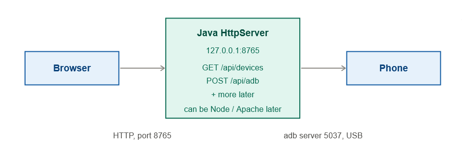
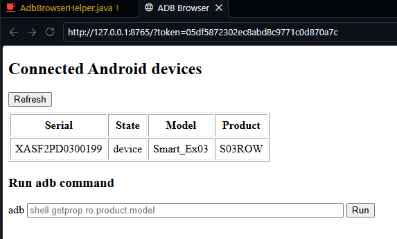

# ADB Browser Helper

A tiny local web server that lets you use `adb` from your browser. A web page
cannot talk to ADB directly, so this Java helper sits in the middle: the page
sends HTTP requests, and the helper runs `adb` on your PC.

```
Browser  ──HTTP──►  Java HttpServer (127.0.0.1:8765)  ──adb──►  adb server (5037)  ──USB──►  Android phone
```


No dependencies. It uses only the JDK's built-in `com.sun.net.httpserver`.

## Features

- Lists connected Android devices as a table (parsed from `adb devices -l`)
- Command box to run any adb command (`shell getprop ...`, `install app.apk`, ...)
- Listens on `127.0.0.1` only, protected by a random per-run token

## Requirements

- JDK 17 or newer
- `adb` installed and on your `PATH` (part of Android
  [platform-tools](https://developer.android.com/tools/releases/platform-tools))
- An Android phone with USB debugging enabled and authorized

## Run

```bash
javac AdbBrowserHelper.java
java AdbBrowserHelper
```

The console prints a URL like:

```
Open http://127.0.0.1:8765/?token=3f9c...
```

Open **that exact URL**, including the token. Use a different port with
`java -Dport=9000 AdbBrowserHelper`.


## API

All `/api/*` requests need the header `X-Token: <token>`.

| Method | Path | Body | Returns |
|--------|------|------|---------|
| `GET`  | `/api/devices` | none | JSON list of devices |
| `POST` | `/api/adb`     | text after `adb`, e.g. `shell ls /sdcard` | plain-text output |

Example:

```bash
curl -H "X-Token: $TOKEN" http://127.0.0.1:8765/api/devices
curl -X POST -H "X-Token: $TOKEN" -d "shell getprop ro.product.model" http://127.0.0.1:8765/api/adb
```

Commands time out after 30 seconds and output is capped at about 1 MB.

## Security

ADB can control a phone (install apps, read files, run shell commands), so
treat this tool carefully.

- Binds to `127.0.0.1` only, so other machines cannot reach it.
- Requires a random token generated at startup. Treat the printed URL like a password.
- Checks the `Host` header (blocks DNS rebinding) and the `Origin` header.
- Commands run as an argument list, never through a shell on your PC.
- `/api/adb` accepts any adb command. Do not expose this server beyond your own machine.

## Troubleshooting

- **`Address already in use`**: another copy is still running on port 8765.
  Stop it, or use `-Dport=<other>`.
  Windows: `Get-NetTCPConnection -LocalPort 8765`, then `Stop-Process -Id <pid>`.
- **"Could not start ADB"**: `adb` is not on your `PATH`.
- **Device shows `unauthorized`**: accept the "Allow USB debugging?" prompt on the phone.
- **Empty list**: check the cable, USB debugging, and run `adb devices` in a terminal.

## Limitations

- Output appears only when a command finishes, so `logcat` needs `-d`
  (live streaming would need WebSockets).
- Starts a new `adb` process per request.

## Roadmap

- Live logcat and shell over WebSocket
- Dedicated endpoints (`/api/install`, `/api/reboot`, ...)
- Structured JSON request format with automatic `-s <serial>`
- Optional port in a Node.js version of the web layer

## License

Copyright 2026 Saurav Pradhan


Licensed under the Apache License, Version 2.0 (the "License");
you may not use this file except in compliance with the License.
You may obtain a copy of the License at

    http://www.apache.org/licenses/LICENSE-2.0

Unless required by applicable law or agreed to in writing, software
distributed under the License is distributed on an "AS IS" BASIS,
WITHOUT WARRANTIES OR CONDITIONS OF ANY KIND, either express or implied.
See the License for the specific language governing permissions and
 limitations under the License.
